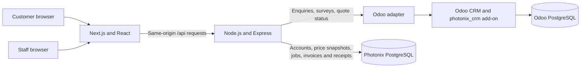

<div align="center">


# Photonix

**Rooftop solar installation management, from the first enquiry to customer sign-off.**

[Problem](#problem-statement) · [Solution](#solution) · [Architecture](#system-architecture) · [Installation](#local-installation) · [Vercel deployment](#deploy-the-frontend-on-vercel)

</div>

## Problem statement

A rooftop solar quotation depends on the customer’s electricity use, available roof area, site conditions, and equipment costs. When sales, survey, warehouse, installation, and finance teams keep separate records, a quote can reach a customer before the roof is approved. Later, the team may struggle to identify which inverter was delivered, who accepted the installation, or how much of an invoice is still outstanding.

## Solution

Photonix gives each profession a workspace for its part of the job. **SolarFit** connects survey approval to package sizing, a bill of materials, and a margin check. Customers can track progress using a private code and download an issued quotation.

| Stage | Who uses it | What happens |
| --- | --- | --- |
| Enquiry | Customer or sales adviser | Capture property details, usage, budget, and contact information. Create an Odoo CRM enquiry and issue a private tracking code. |
| Survey and quotation | Surveyor, reviewer, sales adviser | Record roof measurements, approve or return the survey, and issue a suitable quote. Show gross price, estimated subsidy, and effective cost separately. |
| Dispatch and installation | Warehouse operator and installation crew | Record equipment serials, dispatch, safety checks, power-test results, and the customer’s on-screen acceptance signature. |
| Billing | Customer and finance team | View customer milestone invoices. In the staff ledger, issue installation invoices, record partial payments, and reconcile receipts against the balance. |
| Aftercare and reporting | Support team and director | Look up warranty records, track service requests, and review workload, costs, and outstanding balances. |

The demo uses a local package catalogue and synthetic project records. Savings and subsidy figures are estimates. Recording a receipt demonstrates ledger behavior and does not move money.

## System architecture



**Example — issuing a quotation.** Sales requests a quote through the web app. Express checks the staff session and approved survey, then SolarFit evaluates package size, costs, and margin. The system saves a pricing snapshot and updates the CRM enquiry. The customer can retrieve the issued quote using their private tracking details.

## Tools used

| Layer | Technology | Responsibility |
| --- | --- | --- |
| Web interface | Next.js App Router, React, CSS, Lucide icons | Public website, customer portal, and role-specific staff screens |
| API | Node.js, Express | Workflow rules, authentication, and integration endpoints |
| Identity and request protection | bcryptjs, signed JWTs, Helmet, express-rate-limit | Password hashing, sessions, security headers, and request limits |
| Business records | PostgreSQL, node-postgres | Staff accounts, inventory, installation evidence, billing, and receipts |
| CRM | Odoo 20, Python custom add-on | Lead intake, qualification, surveys, and quotation status |
| Development and testing | PowerShell, Node.js test runner, HTTP smoke tests | Local service startup and workflow verification |

## Repository layout

| Path | Contents |
| --- | --- |
| [web](web/) | Next.js application, public assets, and API rewrite configuration |
| [backend](backend/) | Express API, PostgreSQL schemas, demo fixtures, and tests |
| [addons/photonix_crm](addons/photonix_crm/) | Custom Odoo CRM module |
| [scripts](scripts/) | Isolated Odoo development launcher and bootstrap |
| [ARCHITECTURE.md](ARCHITECTURE.md) | Design blueprint and planned capabilities |

## Local installation

The supplied launchers target **Windows PowerShell**, **Node.js 22.9 or newer**, npm, and a Windows installation of **Odoo 20** with its bundled Python and PostgreSQL tools. Run these commands from the repository root. Adjust the Odoo installation path to match your machine.

### 1. Install dependencies

```powershell
npm --prefix backend install
npm --prefix web install
```

### 2. Initialize the isolated development services

```powershell
$odooInstall = 'C:\Program Files\Odoo 20.0.20261117'
.\backend\setup-identity.ps1 -PgBin "$odooInstall\PostgreSQL\bin"
& "$odooInstall\python\python.exe" .\scripts\odoo-dev.py start
```

The launchers keep local database settings, service credentials, and demo account details under `%LOCALAPPDATA%\Photonix`. The Odoo development instance listens on port **18070**.

### 3. Prepare a fresh demo database

Run this block once on a **new, disposable demo database**. The realistic seed replaces matching demo jobs, serials, and tickets. On an existing demonstration machine with data already loaded, skip to step 4.

```powershell
$demoDb = "$env:LOCALAPPDATA\Photonix\identity-dev\cluster.env"
Push-Location backend
node --env-file="$demoDb" setup-solarfit.js
node --env-file="$demoDb" load-solarfit-demo.js
node --env-file="$demoDb" seed-realistic.js
node --env-file="$demoDb" scripts/apply-customer-schema.js
node --env-file="$demoDb" scripts/seed-demo-households.js
Pop-Location
```

The household seed adds 250 labeled synthetic customer projects and skips existing fixture IDs on subsequent runs. Use a revision containing the customer portal and its schema script for customer account and milestone-invoice screens.

### 4. Build and launch

```powershell
npm --prefix web run build
.\start-sprint1.ps1
Invoke-RestMethod http://127.0.0.1:3100/health
```

Open the [homepage](http://127.0.0.1:3200/), [customer sign-in](http://127.0.0.1:3200/customer/login), or [staff sign-in](http://127.0.0.1:3200/staff). The API health endpoint should return `status: ready`.

### 5. Verify the workflow

Run the web tests with `npm --prefix web test`. With the isolated services running, use `.\start-sprint1.ps1 -Smoke` to exercise the sales, survey, and quotation path against local demo records.

For a presentation, open an approved enquiry, download its quotation, then show a partially paid invoice in Finance. A ₹100,000 invoice with a ₹25,000 receipt should show ₹75,000 outstanding after refresh.

## Deploy the frontend on Vercel

**Deployment boundary:** Vercel builds the Next.js app in `web/`. The current Express and Odoo processes run separately. A hosted frontend needs a reachable HTTPS API and persistent databases for sign-in, enquiry tracking, and billing.

1. Push the revision you intend to deploy to GitHub, including the frontend, matching API, and required schema files.
2. Provision PostgreSQL and Odoo, install the Photonix add-on, and host Express on a service that can reach both. The checked-in Express entry point binds to loopback; configure a suitable listener or a reverse proxy for your hosting environment. Verify the hosted API’s `/health` endpoint.
3. In Vercel, import the GitHub repository. Choose **Next.js** and set **Root Directory** to **web**. Use the framework defaults for build and output.
4. Add **API_ORIGIN** to the Vercel environment you are deploying, for example `https://api.example.com`. Use the origin only, without `/api`. The [rewrite configuration](web/next.config.mjs) forwards browser requests to that service. Redeploy after changing the value.
5. Check the deployed homepage and a database-backed flow such as staff sign-in or customer tracking. A working homepage alone verifies only the frontend.

Keep `DATABASE_URL`, `JWT_SECRET`, and Odoo credentials on the backend host. The local launcher enables demo account helpers for recording. Disable credential-returning demo endpoints and demo setup scripts before public deployment, and use dedicated production accounts.

[Vercel monorepo setup](https://vercel.com/docs/monorepos) · [Vercel deployment environments](https://vercel.com/docs/deployments/environments)
