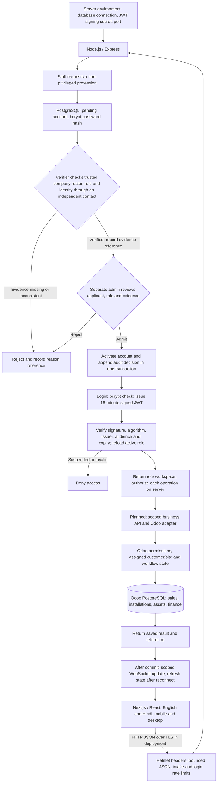
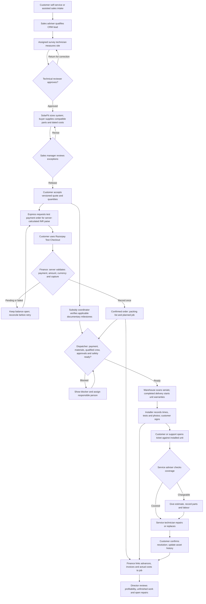

# Photonix system design

The employee identity and admission API is the first local implementation. Business modules, customer authentication, Odoo integration, Razorpay and WebSocket delivery are planned. The existing architecture picture is a summary. This design describes the handoffs.

## From configuration to the first authorized action

The verifier is a human operator who contacts the employer through an established channel, matches the person's identity and requested job to the staff roster and records the check reference. The approver reviews that reference independently. In this slice the evidence is a reference to a separately controlled record. The API records who attested to what and enforces the sequence. Independent document verification and email ownership checks remain integration work. Each company manages initial privileged accounts through a trusted local provisioning step. This first implementation assumes a single company.

## From customer enquiry to service and financial review (planned)

## Data ownership and schema

| Owner and status | Tables or logical records | Links and invariants |
| --- | --- | --- |
| Express identity store, implemented | photonix_auth.account: UUID PK, unique canonical email, password_hash, role, state, verified_by FK, created_at | A pending application has zero business access. Signed token identifies the user. Current database role controls access. |
| Express review history, implemented | photonix_auth.review_event: ID PK, account_id FK, actor_id FK, decision, evidence_reference, recorded_at | State change and review entry commit together. Conditional updates allow one winning transition on concurrent reviews. API exposes no event update or deletion path. |
| Odoo CRM and sales, planned | Contact → site/enquiry → survey revision → quotation revision → lines → order | One customer can have many sites. Quote links to reviewed survey, dated price assumptions and quantity snapshot. |
| Odoo delivery and field work, planned | Order → stock moves/serials → installed assets → warranties. Order → project → visits, technician assignment, timesheets, photos, acceptance | Delivery creates per-unit warranty once. Each visit and cost belongs to one installation. |
| Payments and finance, planned | Order → payment attempt → provider payment → invoice allocation; job → costs | Unique provider order/payment references; amounts in paise for Razorpay. Reconcile capture and prior payments, even if a webhook is repeated. |
| Documents and support, planned | Site/project → subsidy case → private evidence and milestones. Asset → tickets → repairs and replacements | Scope downloads by owner/assignment. Restrict personal documents and financial fields independently of page visibility. |

Express owns staff identity. Odoo owns business transactions. The adapter must map an admitted staff ID to an authorized Odoo principal and enforce record scope. Customers will have a separate owner-scoped identity path. The public enquiry form may create a lead but will never grant access to the customer history. WebSocket subscriptions must apply the same scope as a read request.

## Configuration and keys

| Setting | Where it belongs and what it does |
| --- | --- |
| DATABASE_URL, JWT_SECRET, PORT | Current backend environment. Use a dedicated PostgreSQL identity database and high-entropy JWT secret. Example names live in backend/.env.example. JWT is an access token; bcrypt hashes passwords. |
| BOOTSTRAP_ADMIN_EMAIL/PASSWORD and BOOTSTRAP_VERIFIER_EMAIL/PASSWORD | One-time local environment values for two trusted operators when initializing an empty development identity database. Remove bootstrap secrets after setup. |
| Odoo base URL, development database, restricted integration credentials | Planned server configuration. Verify the supported local integration and user mapping before connecting business routes. |
| RAZORPAY_KEY_ID, RAZORPAY_KEY_SECRET, RAZORPAY_WEBHOOK_SECRET | Planned Test Mode configuration. Checkout can receive the public key ID and order ID. Keep both secrets on the server. Verify callback signatures and webhook signatures using the corresponding secrets. |
| Browser API origin | Public deployment routing only. Use a same-origin entry point for frontend/API. Keep bearer tokens in memory for this design. Serve HTTPS/WSS in deployment; local test server uses loopback. |

Razorpay and Odoo credentials are unnecessary for the current admission tests. Generated images, if used, are static frontend assets.

## Run and test the first backend slice

From the Desktop project, open PowerShell in backend. Install locked dependencies with npm ci. Run ./test-local.ps1 to start an isolated temporary PostgreSQL cluster, execute the HTTP integration suite and shut down the cluster. A different PostgreSQL installation can be supplied with -PgBin. The script expects the PostgreSQL 16 installation included with the local Odoo runtime.

For a persistent local development instance, create the dedicated photonix_identity_dev database with an owner scoped to it. Copy .env.example to the ignored .env file, set its connection string and a random signing secret, then supply the four bootstrap values through the local process environment. Run node --env-file=.env init-dev.js once, clear the bootstrap variables, then npm start. The API binds to 127.0.0.1 on port 3100 by default. The development setup is separate from the active Odoo database.

| Method and route | Access |
| --- | --- |
| GET /health | Reports readiness when the identity schema is available |
| POST /api/staff/applications | Public staff application: email, password, role |
| POST /api/login | Active staff credentials; returns accessToken |
| GET /api/me | Bearer token; returns current user ID, role and workspace |
| GET /api/staff/applications | Verifier sees pending requests; admin sees verified requests with their evidence reference |
| POST /api/staff/applications/:id/decisions | Authorized human reviewer; body contains decision and evidenceReference |

Next integration gate: create a synthetic enquiry under the admitted sales role, persist it in Odoo CRM, prove cross-customer access is denied, and replay the request without duplicating the lead.